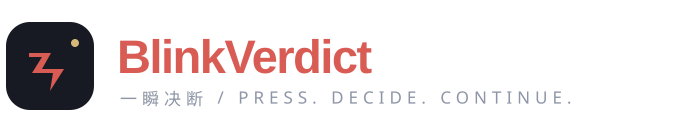

<p align="center">
  
</p>

<h3 align="center">给眼前的选择，一个答案。</h3>

<p align="center">设定目标，写下选项，按下快捷键。<br/>BlinkVerdict 看一眼当前屏幕，让答案轻轻浮现。</p>

<p align="center">
  <a href="#开始使用"><strong>开始使用</strong></a> &nbsp;·&nbsp;
  <a href="#让答案以你喜欢的方式出现"><strong>外观与显示</strong></a> &nbsp;·&nbsp;
  <a href="#用你选择的模型"><strong>模型服务</strong></a> &nbsp;·&nbsp;
  <a href="#你的画面由你掌握"><strong>隐私</strong></a>
</p>

<p align="center">
  
  
</p>

<p align="center"><a href="docs/showcase.md"></a><br/><sub>外观预览。完整短片与下载入口见 <a href="docs/showcase.md">产品演示</a>。</sub></p>

## 为需要做选择的那一刻

有时候，你需要的只是从几个选项中选出下一步。

告诉 BlinkVerdict 你想判断什么，比如“根据当前局面选择进攻、撤退或等待”。需要时按下 **Ctrl + Alt + Space**，它会读取当前屏幕，请你选择的模型给出一个答案。

| 想让答案短暂出现 | 想让答案留在身边 |
|---|---|
| **全屏浮现**：答案在屏幕上轻柔出现，随后淡去。 | **悬浮组件**：一小块通透的浮层，等待下一次按键。 |
| 适合偶尔需要一次判断的时候。 | 适合希望持续看到最新结果的时候。 |
| 默认停留 1.5 秒，时长可调整。 | 默认持续显示，也可以定时收起。 |

两种方式共用你的选项、模型与外观。模型证据不足时，可以明确返回“无法判断”。AI 的判断仅供参考。

## 开始使用

**[下载 Windows 预览版](https://github.com/Amadeus2027/blink-verdict/actions/workflows/check.yml?query=branch%3Amain+is%3Asuccess)**

下载页面中选择最近一次成功构建，获取 `blink-verdict-windows-x64-preview`，解压 ZIP 后运行 `blink-verdict.exe`。下载需要登录 GitHub。程序单文件运行，无需管理员权限。

**1. 选择模型。** 首次打开会进入“模型”。选择云端或本机服务，填写模型名称，以及服务需要的地址和密钥，然后点击“下一步”。

**2. 写下你的决策。** 在“决策”中填写想判断的事情，以及每行一个的答案。默认是 YES / NO，也可以换成“进攻 / 撤退 / 等待”等自己的选项。点击“完成设置”。

**3. 需要时，按一下。** 默认快捷键为 **Ctrl + Alt + Space**。想更换时，点击“决策快捷键”并直接按下新的组合键。

平时程序留在系统托盘中。单击托盘图标返回设置，右键可暂停决策、切换显示方式或调整浮窗。判断进行时重复按键不会叠加请求。

## 让答案以你喜欢的方式出现

设置采用浅色分组布局。常用选项放在眼前，精细调整留在需要时打开。

- **出现方式**：直接出现、轻柔浮现、闪现、缩放进入、向上浮入。
- **颜色与时长**：调整文字、背景、不透明度、字号和停留时间。
- **位置与大小**：直接拖动、缩放悬浮组件，右键完成；也可以填写精确位置。
- **字效与图片**：选择血墨书法、赛博故障或霓虹涂鸦，或为自己的答案选择透明 PNG。

点击“预览效果”可以先看一眼。预览不会读取屏幕或请求模型，也不会保存你的改动；点击“完成”后设置才生效。“取消”会放弃本次更改。

<details>
<summary>看看三种字效</summary>


内置字效适用于 YES / NO，其他答案使用你选择的字体。自定义 PNG 会覆盖该答案的内置字效，保持透明背景并使用同一套动画。图片保留在原位置，移动文件后需要重新选择。

</details>

浮窗的模糊背景由 Windows 提供，效果随系统设置而变化；关闭透明效果或使用高对比度时会采用更清晰的表面。已有用户的字体、颜色和显示时长会保留。

## 用你选择的模型

专用决策模型、常规视觉模型，以及你自己运行的本地服务，都可以接入。

| 你想使用的服务 | 可选连接 |
|---|---|
| 专用决策模型 | TypeSafe Jev、Perplexity Decider、Cloudflare Clef、OpenAI Decisions |
| 常规模型 | OpenAI、Anthropic、Google Gemini，以及兼容服务 |
| 本机运行 | System One / vLLM、Ollama、LM Studio 等匹配所选协议的服务 |

可以发送屏幕画面，也可以选择在本机提取文字后再发送。图片输入需要服务与模型支持视觉能力。Jev 的图片能力具有实验性质；本地模型需要自行安装和启动。

专用决策服务返回的选项概率、置信度和最近状态，可以在托盘的“状态与连接信息”查看。置信度不代表正确率保证。

[查看服务地址、账号和本地连接说明 →](docs/models.md)

## 安静待命，按需工作

BlinkVerdict 采用原生 Rust 实现，不附带浏览器运行时或模型。仅在你触发时读取屏幕、执行 OCR 或请求决策；设置按需打开，显示停止后结束动画刷新。

本地模型的内存与显存开销取决于你运行的服务。实际资源占用与兼容记录见 [验证说明](docs/validation.md)。

## 你的画面，由你掌握

- 仅在按下快捷键时读取当前前台应用所在的显示器。
- 不默认保存截图或判断历史，没有遥测或自动更新请求。
- 使用云端模型时，画面或 OCR 文字、判断目标与选项会发送给你配置的服务；本地模式发给对应本机服务。
- API 密钥保存在 Windows 凭据管理器中，普通设置文件不含密钥。

## 在游戏中使用

显示层保持点击穿透，并按不激活窗口的方式显示。桌面与无边框游戏使用桌面浮层；独占全屏可尝试单独安装 [Game Bar 组件](docs/gamebar.md)。不同游戏、反作弊与受保护画面的限制需要分别确认。

当前为预览版，游戏焦点、输入与资源占用仍在实机验证范围内。[查看兼容说明 →](docs/compatibility.md)

<details>
<summary>从源码构建与参与项目</summary>

在 Windows 安装 Rust 与 Visual Studio C++ Build Tools，然后运行：

```powershell
git clone https://github.com/Amadeus2027/blink-verdict.git
cd blink-verdict
cargo build --locked --release
.\target\release\blink-verdict.exe
```

[更新记录](CHANGELOG.md) · [核心检查与发行验证](docs/testing.md) · [录制说明](docs/showcase.md)

</details>
