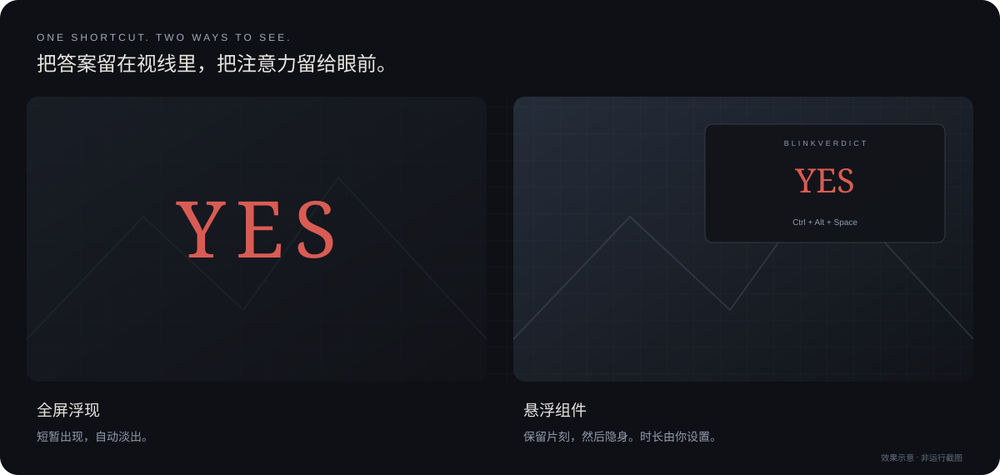

<p align="center">
  
</p>

<h3 align="center">按一下，让决策浮现。然后继续眼前的事。</h3>

<p align="center">轻量 Windows AI 决策助手：快捷键截屏，让模型从你设置的选项中做出选择。<br/>全屏浮现或悬浮组件，两种模式，一套风格。</p>

<p align="center">
  <a href="#快速开始"><strong>快速开始</strong></a> &nbsp;·&nbsp;
  <a href="#两种显示方式"><strong>显示模式</strong></a> &nbsp;·&nbsp;
  <a href="#模型接入"><strong>模型接入</strong></a> &nbsp;·&nbsp;
  <a href="docs/gamebar.md"><strong>Game Bar</strong></a> &nbsp;·&nbsp;
  <a href="docs/testing.md"><strong>测试与发行</strong></a>
</p>

<p align="center">
  
  
  
  <a href="https://github.com/Amadeus2027/blink-verdict/actions/workflows/check.yml"></a>
</p>

<p align="center"><br/><sub>效果示意，非运行截图。实际效果以 Windows 构建为准。</sub></p>

> **开发预览**：当前提供实现源码与 Windows 构建工作流。桌面焦点、游戏覆盖、Game Bar 和资源占用均须 Windows 实机验收；尚无已验证的独占全屏游戏清单。不是稳定发行版。

## 两种显示方式

| 全屏浮现 | 悬浮组件 |
|---|---|
| 像《只狼》死亡提示一样，暗幕上短暂浮现决策文字。 | 像资源监视器一样，用小组件显示判断状态和结果。 |
| 默认淡入淡出，共 **1.5 秒**。 | 新安装默认 **持续显示**，也可设置结果后自动隐藏。 |
| 显示在被截取的显示器。 | 保留你设置的位置和大小。 |

- 两种模式通过托盘或设置切换，共用判断指令、答案选项、模型和配色。
- 字体、颜色、整体不透明度、动画可调整；字号和显示时长分别设置。
- 动画可选 **无动画 / 渐入渐出 / 闪现 / 缩放弹入 / 上浮进入**，文字与字效图片均可使用。
- 内置三组 AI 生成的 `YES / NO` 字效：血墨书法（只狼灵感）、酸黄故障（《赛博朋克 2077》灵感）、霓虹涂鸦（迈阿密灵感）。在“字效”页选择；自定义答案可绑定自己的透明 PNG。
- “外观”页勾选“悬浮常驻”即可一直显示；已有配置的隐藏时长会保留。默认点击穿透；“浮窗”页可填写 X/Y、宽高及恢复默认，也可从托盘进入编辑状态后拖动或缩放。
- 显示层使用不激活窗口，不主动切换焦点，不拦截游戏键鼠输入；游戏中的实际行为仍需验证。

## 快速开始

### 1. 获取 Windows 程序

在 [Actions](https://github.com/Amadeus2027/blink-verdict/actions/workflows/check.yml) 中打开一次成功的 **Windows build and core checks**，下载 `blink-verdict-windows-x64-preview` 构建产物，解压其中的 ZIP，再解压运行 `blink-verdict.exe`。构建产物需要登录 GitHub 下载，并有保存期限。程序是单文件 EXE，内置字效已嵌入，不需要额外复制素材目录。

也可以在 Windows 安装 [Rust](https://rustup.rs/) 和 Visual Studio C++ Build Tools 后从源码构建：

```powershell
git clone https://github.com/Amadeus2027/blink-verdict.git
cd blink-verdict
cargo build --locked --release
.\target\release\blink-verdict.exe
```

首次启动自动打开设置；之后单击托盘图标即可返回。右键托盘提供模式切换、暂停 / 恢复快捷键、收起显示和状态查看。不需要管理员权限，不自动设置开机启动。

### 2. 设置模型与判断任务

在“模型”页选择专用决策模型或常规模型服务预设，选择后自动填入，填写实际模型名、地址及需要的 API 密钥，并选择截图输入或 OCR 输入。新安装默认选择 TypeSafe Jev，已有配置保留原协议和地址。本地决策服务也有独立预设，需要自行启动相应服务。密钥留空保留当前地址已有密钥；切换地址或协议会清空未保存密钥，避免误用。通过“删除此地址的密钥”显式删除，应用或确定后生效。

在“决策”页填写目标，以及每行一个的答案：

```text
判断指令：根据当前游戏局面，选择更适合的下一步战术；不确定就放弃判断。

答案选项：
进攻
撤退
等待
```

默认选项是 `YES / NO`，允许 2–20 个选项，每项不超过 80 字。**选项之外还需要明确的判断目标**；目标不清楚或证据不足时，模型应返回“无法判断”。AI 结果仅供参考。

### 3. 按快捷键

默认 **`Ctrl + Alt + Space`**：

```text
触发 → 截取当前屏幕 → 专用决策模型 / 常规模型 → 选择答案 → 显示 → 隐身
```

截图先于“判断中”组件出现，避免将自身结果作为输入。处理期间重复按键不排队；设置或窗口编辑期间暂停响应决策快捷键。错误只留在托盘状态中，可从“查看状态 / 最近错误”读取。

<details>
<summary>快捷键、样式与多屏设置</summary>

- 快捷键支持 Ctrl / Alt / Shift / Win 搭配字母、数字、Space、F1–F24。占用冲突会在设置时提示。
- “预览 · 不保存”用当前外观显示两秒，设置窗口保持打开；不保存配置、不截图、不请求模型。未完成的模型或快捷键字段不会阻止外观预览。设置预览使用原生通道；托盘预览使用已保存配置及实际显示通道。
- “应用”保存并继续编辑，“确定”保存并关闭，“取消”或关闭按钮会处理未保存的修改。页签切换保留未填完的字段，错误在应用时定位到对应页面。
- 浮窗可从“浮窗”页点“应用并拖动调整”；编辑不改变当前显示模式。右键浮窗或从托盘锁定即恢复点击穿透。
- 暂停会释放决策快捷键；恢复时重新检查按键冲突。忙碌或设置打开时，不可执行的托盘操作会置灰。
- 字号与窗口几何采用物理像素；颜色使用六位 HEX。整体不透明度范围为 30–255，会同时影响背景和文字。
- 全屏时长为 300–60000 毫秒；悬浮时长为 0–600000 毫秒。
- 当前截图取前台窗口所在显示器，而不是只截取窗口内部。截图最长边缩至最多 1600 像素。
- 悬浮窗口在显示器变化后会在下次显示时调整回可见工作区。

</details>

<details>
<summary>字效预览与自定义图片</summary>


图片是图像生成工具制作的字效素材，不是可输入任意文字的字体文件。内置素材匹配 YES / NO（忽略大小写）；其他文字保留原生字体渲染。

在“字效”页选中答案后，可选择本机 PNG，覆盖该答案的默认字效。图片按比例缩放，保留透明通道，共用选择的动画。原生通道支持不超过 8 MB、4096×4096 的 PNG；Game Bar 自定义图须不超过 32 KB。文件路径保存在配置中，移动文件后需要重新选择。

字效只在结果显示时解码和加载，内置图集只复制当前答案的像素区域，隐身时释放渲染资源；不会为用户每次触发在线生成图片。

</details>

## 模型接入

| 接口 | 云端 / 本机 | 屏幕输入 |
|---|---|---|
| TypeSafe Jev · `/systemone` | TypeSafe API；或实现同一协议的本地服务 | OCR；图片为厂商实验能力 |
| Perplexity Decider · `/decisions` | Perplexity API；或实现同一协议的本地服务 | 图片或 OCR，取决于服务版本 |
| Cloudflare Clef · Workers AI | Cloudflare API，地址中填写 Account ID | 图片或 OCR |
| OpenAI Decisions · `/decisions` | OpenAI API；或实现此协议的本地服务 | 云端图片 / OCR；vLLM 当前仅文字 |
| 本地 System One · `/systemone` | vLLM 等，包含 `images` 图片扩展 | 图片或 OCR，取决于模型 / 服务 |
| OpenAI 兼容 Chat Completions | OpenAI、Qwen、SiliconFlow、OpenRouter、LM Studio 等 | 视觉模型用图片；文字模型用 OCR |
| OpenAI Responses | OpenAI 及兼容此协议的服务 | 图片或 OCR |
| Anthropic Messages | Anthropic 或兼容服务 | 图片或 OCR |
| Gemini generateContent | Google 或兼容服务 | 图片或 OCR |
| Ollama `/api/chat` | 已运行的本机服务 | 已安装的视觉模型或文字模型 |

**专用决策接口发送结构化选项，并直接读取 choice、选项概率和置信度；常规模型继续使用 JSON 答案约束。** 托盘“查看状态 / 最近错误”可查看服务返回的概率和置信度。所有选项之外增加“无法判断”，不将低置信度数值自动等同于错误，也不将置信度视为正确率保证。

本地与云端均可修改基础地址、模型名和密钥；本地无认证时密钥可留空。**模型权重名称不代表接口协议**：本地 Clef 等服务通常应选择 System One，不能直接套用 Cloudflare 云端路径。预设是配置起点，不代表已经安装模型或验证了真实服务。[协议、地址填写和本地接入说明](docs/models.md)

<details>
<summary>本地模型、推理模型与接口限制</summary>

- 本地决策服务、Ollama / LM Studio 需要用户自行安装、启动和下载模型。主程序不内置模型，也不在后台自动启动模型服务。
- Ollama 请求使用 `keep_alive: 0` 请求服务在本次推理结束后卸载模型，实际释放由服务决定。模型运行期间的内存 / 显存另计。
- OCR 使用 Windows 已安装的用户语言包，适合文字界面，不能代替视觉模型理解图形、空间关系或完整游戏场景。
- 默认模型网络请求超时 15 秒，可设为 1–120 秒；常规模型默认最大输出 1024 tokens，可设为 64–8192；专用决策不发送输出 token 参数。OCR 和可选 IPC 耗时另计。
- 某些推理模型需要更大的输出额度或不同接口；例如不支持 Chat Completions `max_tokens` 的模型应使用 Responses。厂商私有参数和非兼容协议不保证支持。
- 接口要求 HTTPS，只有本机回环地址允许 HTTP；不跟随重定向，不将服务原始错误内容写入日志或通知。
- 截图输入与 OCR 输入由用户明确选择，不自动将不支持图片的模型降级。

</details>

## 界面与交互

界面参考 iOS 深色模式的克制层级：侧栏导航、圆角输入区、轻边框与明确的主次按钮。设置窗口在支持的 Windows 11 系统使用原生 acrylic 背景，不支持时回退到实色；悬浮组件使用带透明度的圆角显示层。它是 Windows 原生实现，不是 iOS 移植，也不依赖 WebView。

交互取舍参考 [Rainmeter 的管理 / 锁定](https://docs.rainmeter.net/manual/user-interface/manage/)、[ShareX 的悬浮操作](https://getsharex.com/docs/pin-to-screen)与 [PowerToys 的状态反馈](https://learn.microsoft.com/en-us/windows/powertoys/always-on-top)。[录制与展示说明](docs/showcase.md)

## 游戏兼容与隐私

普通桌面和无边框游戏使用原生置顶显示层。独占全屏可能绕过桌面合成，普通覆盖窗口不能保证显示；可选 [Game Bar 组件](docs/gamebar.md) 提供另一条显示路径，**当前为未实机验证的实验性实现**。

不注入游戏进程，不安装图形 Hook，不自动打开 Game Bar 面板。Game Bar 通道需手动安装、打开、固定并开启点击穿透；不满足条件则跳过显示，不自动回退到其他通道。捕获黑屏、受保护画面和反作弊限制可能使决策不可用。[兼容记录](docs/compatibility.md)

- 只在按键时截图；不持续监听屏幕、不默认保存截图或历史，没有遥测和自动更新请求。
- 云端服务会收到本次截图或 OCR 文本，以及判断指令和选项；处理政策与费用由服务方决定。本地模式将这些数据发给你配置的本地服务。
- API 密钥按协议和地址隔离保存在 Windows 凭据管理器，目标名以 `BlinkVerdict/` 开头；普通配置位于 `%LOCALAPPDATA%\BlinkVerdict\config.json`，不包含密钥。
- 可选 Game Bar 组件只接收结果和样式，不接收截图、OCR、指令或密钥。

## 低占用目标

原生 Rust + Win32 + Direct2D / DirectWrite，不依赖 Electron 或 WebView。网络使用 Windows WinHTTP，PNG 使用 Windows Imaging Component，不携带异步网络运行时或第三方 PNG 编解码器。设置窗口按需创建；隐身时释放渲染资源、停止动画计时器；不持续截图、轮询模型或执行 OCR。

隐身待命目标为私有工作集 **≤ 30 MB**、60 秒平均 CPU **< 0.1%**。这是待测目标，尚无 Windows 性能数据；可选组件和本地模型占用单独记录。[性能采样与发行清单](docs/testing.md)

## 开发与发行

遵守 [Andrej Karpathy Skills](https://github.com/forrestchang/andrej-karpathy-skills)：明确假设、保持简单、只改必要内容、验证关键行为。具体约定见 [AGENTS.md](AGENTS.md)。README 的组织与视觉呈现参考 [archify](https://github.com/tt-a1i/archify)，素材和产品说明独立维护。

```powershell
# 日常：核心四组；Windows 另加一项原生 PNG 冒烟，以及必要编译检查
cargo test --locked --lib
cargo check --locked

# 发行前：另行执行网络回归与 Windows / 游戏 / 性能检查
cargo test --locked --test release_providers -- --ignored
```

完整测试放在 [发行前测试清单](docs/testing.md) 和独立的 ignored 集成测试中，不纳入日常默认工作流。每次发行必须记录实际执行结果；编译成功不代表 Windows 游戏兼容通过。

目前没有稳定版发行承诺；[变更记录](CHANGELOG.md) · [提交问题](https://github.com/Amadeus2027/blink-verdict/issues) · [源码](https://github.com/Amadeus2027/blink-verdict)
