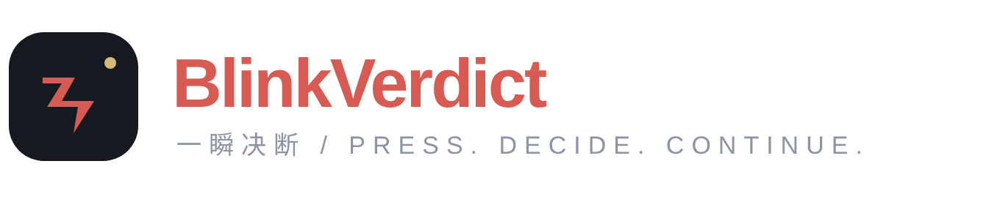

<p align="center">
  
</p>

<h3 align="center">给眼前的选择，一个答案。</h3>

<p align="center">为 Windows 打造的快捷键决策助手。<br/>设定目标与选项，按下快捷键，让模型结合当前屏幕给出选择。</p>

<p align="center">
  <a href="#下载与安装"><strong>下载</strong></a> &nbsp;·&nbsp;
  <a href="#三步开始"><strong>开始使用</strong></a> &nbsp;·&nbsp;
  <a href="docs/showcase.md"><strong>产品演示</strong></a> &nbsp;·&nbsp;
  <a href="docs/models.md"><strong>模型配置</strong></a> &nbsp;·&nbsp;
  <a href="#隐私与数据"><strong>隐私</strong></a>
</p>

<p align="center"><sub>Windows x64 · 本地与云端模型 · 原生 Rust · <a href="LICENSE">MIT</a></sub></p>

<p align="center"><a href="docs/showcase.md"></a><br/><sub>39 秒原画短片与全部章节见 <a href="docs/showcase.md">产品演示</a>。GIF 约 1 MB。</sub></p>

## 在需要做选择时，按一下

把“下一步做什么”写成一个目标，再列出允许的答案。例如：根据当前局面，从“进攻 / 撤退 / 等待”中选择下一步。需要判断时按下 **Ctrl + Alt + Space**，结果会以你设定的方式出现。

| 全屏浮现 | 常驻浮窗 |
|---|---|
| 只显示文字或透明字效，没有背景、遮罩或屏幕变暗。 | 圆角半透明背景，保留最近一次结果。 |
| 默认 1.5 秒后淡去，显示时长可调整。 | 可拖动、缩放、精确定位，背景透明度独立调整。 |
| 适合偶尔需要一个答案的时候。 | 适合持续查看最新结果，也可以定时收起。 |

两种方式共享模型、目标与选项。证据不足时可以返回“无法判断”；模型判断可能出错，请自行核实。

## 下载与安装

**[查看发行包](https://github.com/Amadeus2027/blink-verdict/releases)** · [更新记录](CHANGELOG.md) · [版本验收状态](docs/releases/0.1.0-rc.1.md)

**0.1.0-rc.1 候选版**已通过自动发行检查，尚未发布稳定版。可从[候选构建任务](https://github.com/Amadeus2027/blink-verdict/actions/runs/39963660804)下载 `release-candidate-windows-x64`（需登录 GitHub，附件有保留期限）。正式下载以 Releases 中的公开附件为准；发行草稿尚未公开。

| 项目 | 说明 |
|---|---|
| 系统目标 | Windows 10 22H2 / Windows 11，x64；消费版兼容性验收进度见下方说明 |
| 运行方式 | 解压 ZIP，运行 `blink-verdict.exe`；无需安装或管理员权限 |
| 模型要求 | 可用的 API 账号，或已在本机运行的兼容服务；程序不附带模型权重 |
| 下载校验 | 使用同一发行页的 `SHA256SUMS.txt` 核对 ZIP；包内附来源与文件清单 |
| 代码签名 | 当前未做 Authenticode 签名，Windows 可能显示未知发布者 |

<details>
<summary>尚无公开发行包时，获取开发构建</summary>

打开 [成功的主分支构建](https://github.com/Amadeus2027/blink-verdict/actions/workflows/check.yml?query=branch%3Amain+is%3Asuccess)，选择 `blink-verdict-windows-x64-preview` 附件，解开附件后再解压其中的程序 ZIP。构建附件需要登录 GitHub，且可能过期；它不是稳定发行版。

</details>

## 三步开始

1. **连接模型。** 首次打开进入“模型”。选择服务，填写模型名称、地址和需要的密钥，点击“下一步”。本地模型服务需要先自行启动。
2. **设定选择。** 填写想判断的事情，再输入每行一个的答案。默认 YES / NO，也可使用自己的 2–20 个选项，然后点击“完成设置”。
3. **按键获取答案。** 默认快捷键为 **Ctrl + Alt + Space**。点击“决策快捷键”后直接按下新组合键，即可更换。

平时程序留在托盘中。单击图标打开设置；右键可暂停、切换显示方式或调整浮窗。判断中重复按键不会叠加请求。退出时使用托盘菜单的“退出”。

## 让答案符合你的习惯

- **文字与字效**：自选字体、字号与颜色；内置清晰纯色、流光玻璃、柔彩手写三种 YES / NO 字效，也支持为自己的答案选择透明 PNG。
- **出现动画**：直接出现、轻柔浮现、闪现、缩放进入、向上浮入。
- **显示时长**：全屏浮现可设 0.3–60 秒；浮窗可持续显示或定时收起。
- **浮窗布局**：拖动和边缘缩放，也可输入位置与尺寸；完成调整后恢复点击穿透。
- **独立透明度**：浮窗背景从完全透明到实色均可调节，文字透明度另行设置。

“预览效果”不读取屏幕、不请求模型、不保存改动；点击“完成”才会保存，“取消”放弃本次修改。当前浮窗提供半透明表面；玻璃字效属于预绘制图片，不包含实时背景模糊或折射。

<details>
<summary>查看三种内置字效</summary>


预设保留图片本身的颜色，适用于 YES / NO；其他答案使用所选字体。想自由调色时使用“简洁文字”。自定义透明 PNG 优先于内置字效，移动或删除原文件后需要重新选择。

</details>

## 选择你信任的模型

| 连接类型 | 已实现的接口与预设 |
|---|---|
| 专用决策 | TypeSafe Jev、System One、Perplexity Decider、Cloudflare Clef、OpenAI Decisions |
| 常规模型 | OpenAI Chat Completions / Responses、Anthropic、Google Gemini、Ollama，以及匹配协议的兼容服务 |
| 本机服务 | System One / vLLM、Ollama、LM Studio 等已启动的兼容服务 |

可发送屏幕截图，或先在本机 OCR 提取文字。截图需要模型支持视觉；文字模型使用 OCR。**接口实现不等于已完成厂商在线认证**：目前协议测试使用合成样例与回环服务，真实服务及权重运行的验收状态见版本记录。

专用接口提供的概率和置信度可在托盘“状态与连接信息”查看，不构成正确率保证。第三方服务的账号、费用和可用性由相应提供方决定。

[查看地址、模型名称、输入能力与本地配置 →](docs/models.md)

## 轻量待命，按需工作

采用原生 Rust 与 Windows 接口，不附带浏览器运行时或本地推理引擎。仅在触发决策时读取屏幕、执行 OCR 或请求模型；显示结束后停止动画刷新。

本次 x64 候选包约 **0.9 MB**，主程序约 **1.15 MB**。在 Windows runner 的每组 60 次采样中，使用后待命的平均私有工作集约 **3.2 MiB**，常驻浮窗约 **5.7 MiB**。这些是该环境的观测值，不是所有设备的占用承诺；本地模型的内存与显存开销另计。[查看完整测量条件 →](docs/releases/0.1.0-rc.1.md)

## 隐私与数据

- 只在决策触发时读取当前前台应用所在的显示器，不进行后台连续截屏。
- 不默认保存截图、判断历史，没有遥测或自动更新请求。
- 云端模型会收到本次截图或 OCR 文字、目标与选项；本地模式发送给你配置的本机服务。服务方如何留存数据取决于其政策。
- API 密钥保存在 Windows 凭据管理器；普通设置文件不含密钥。

## 兼容性与当前边界

桌面浮层按不激活窗口、点击穿透的方式显示。**目前没有已认证兼容的游戏**；独占全屏、反作弊与受保护画面均可能限制捕获或显示。建议先在无边框模式验证。[Game Bar 组件](docs/gamebar.md)属于单独安装的实验组件，不包含在主程序候选包中。

[兼容记录](docs/compatibility.md) · [当前候选版验收](docs/releases/0.1.0-rc.1.md)

## 常见问题

**如何更新或卸载？** 从托盘退出后替换程序即可。设置位于 `%LOCALAPPDATA%\BlinkVerdict\config.json`，与程序分开放置。卸载时删除程序；若需清除设置和密钥，再删除该配置目录及凭据管理器中以 `BlinkVerdict/` 开头的项目。

**没有结果或提示失败？** 先看托盘“状态与连接信息”。确认地址、密钥、模型能力和本地服务状态；OCR 需要 Windows 对应语言包。黑屏或受保护内容请尝试无边框模式。[连接说明](docs/models.md)

**是否完全离线？** 使用本机服务且其模型已就绪时，决策可留在本机。服务的下载、联网行为和资源开销由所用推理软件决定。

## 参与项目

通过 [Issues](https://github.com/Amadeus2027/blink-verdict/issues)反馈问题或建议。请提供版本、Windows 构建号、显示缩放、复现步骤，以及脱敏后的错误提示；不要上传密钥或私人屏幕画面。

<details>
<summary>源码构建与验证</summary>

安装 Rust stable 与 Visual Studio C++ Build Tools，在 Windows 执行：

```powershell
git clone https://github.com/Amadeus2027/blink-verdict.git
cd blink-verdict
cargo build --locked --release
.\target\release\blink-verdict.exe
```

日常只运行最小核心检查；完整网络、资源与兼容验收安排在发行前。[测试说明](docs/testing.md) · [发行流程](docs/releases/README.md) · [构建与实机证据](docs/validation.md)

</details>

本项目采用 [MIT 许可证](LICENSE)。第三方依赖保留各自许可，候选包包含相应声明。BlinkVerdict 不隶属于所连接的模型厂商。
